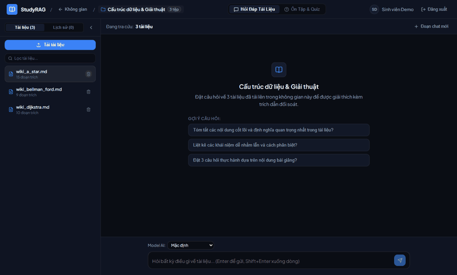

# StuQuiz

A study assistant for your own lecture notes and papers: answers are grounded in the uploaded
documents, cite the passage they came from, and refuse when the documents don't say. The same
material becomes server-graded quizzes with a per-topic mastery score.

[](https://github.com/VinhDoan1604/StuQuiz/actions/workflows/ci.yml)


🇻🇳 [Bản tiếng Việt](README.vi.md)

<p align="center"></p>

## Summary

I built the full agentic pipeline (corrective RAG, a self-critic, hybrid search), then measured each
component with an ablation harness. On 81 questions, **CRAG and the critic cost 2–3× the tokens with
no measurable quality gain**, and sparse retrieval added nothing once reranking was on. Production
therefore runs the simpler pipeline: dense search, cross-encoder rerank, one generation. The reranker
clearly improved ranking (MRR 0.735 → 0.846), but answer correctness did not change, because the
evidence was usually in the top 5 already. The expensive paths stay in the code behind flags.

## How it works

1. **Orchestrator** classifies the intent (`qa`, `teaching`, `quiz`, `summary`) and, in the same LLM
   call, rewrites follow-ups such as "explain that more simply" into standalone questions.
2. **Retrieval**: BGE-M3 dense top-10 → `bge-reranker-v2-m3` cross-encoder (int8) → child-to-parent
   expansion, always filtered to the user's own documents.
3. **Generation** answers from the retrieved text only, with numbered citations, and streams tokens
   over SSE. Retrieved text is fenced as data against prompt injection.
4. **Optional loop** (`ENABLE_CRAG`, `ENABLE_ANSWER_CRITIC`, off by default): grade the context and
   rewrite the query, then check the answer's faithfulness and regenerate.

Ingestion: PDF (PyMuPDF → pypdf → Tesseract `vie` OCR, or `OCR_ENGINE=vlm`), DOCX, PPTX, TXT, MD →
Unicode NFC → heading-aware parent/child chunks → Qdrant.

| Layer | Tech |
|---|---|
| API | FastAPI, SSE, JWT, argon2id, Google Sign-In, email OTP, Redis rate limits and daily quotas |
| Orchestration | LangGraph `StateGraph` ([`app/graph/build_graph.py`](app/graph/build_graph.py)) |
| Models | Gemini / OpenAI / Anthropic through a cheap/strong router with fallback ([`app/llm/router.py`](app/llm/router.py)); self-hosted BGE-M3 and reranker |
| Storage | PostgreSQL 16 + Alembic, Qdrant |
| Frontend | React 19 + Vite + TypeScript, nginx |
| Ops | Docker Compose, Caddy (HTTPS), GitHub Actions CI, JSON logs with request IDs, per-node latency and token usage stored with every answer |

## Evaluation

The harness ([`eval/`](eval/README.md)) adds one component at a time, scores retrieval (hit@k, MRR)
and answers (correctness and faithfulness from an LLM judge that is a different model from the
generator), and reports 95 % bootstrap CIs, with paired bootstrap for differences.

**`final-v1`**: 81 reviewed questions over 18 public documents ([`eval/CORPUS.md`](eval/CORPUS.md)):
58 answerable, 23 unanswerable (12 near-miss), 23 in informal student phrasing. Generator
`gemini-2.5-flash`, judge `gpt-5.4`. Reports: [summary](eval/results/final-v1/report.md),
[production vs CRAG/full](eval/results/final-v1/compare.md),
[dense vs production](eval/results/final-v1/compare_dense.md).

| Config | Faithfulness | Correctness | Correct refusal | p50 latency | LLM calls | Tokens |
|---|---|---|---|---|---|---|
| `dense` | 0.949 [0.924–0.972] | 0.957 [0.905–0.991] | 22/23 | 4.6 s | 1.0 | 2,516 |
| **`production`** | **0.968** [0.945–0.988] | **0.957** [0.905–0.991] | **22/22**¹ | 10.3 s | 1.0 | 3,019 |
| `crag` | 0.952 [0.925–0.973] | 0.940 [0.888–0.983] | 22/23 | 14.1 s | 2.7 | 6,087 |
| `full` (CRAG + critic) | 0.963 [0.941–0.982] | 0.957 [0.905–0.991] | 22/23 | 17.8 s | 3.7 | 8,923 |

¹ One request got no response from the LLM provider, so it has no score.

- **CRAG and the critic did not pay for themselves.** No quality metric improved over `production`
  (every CI includes 0); `crag` added 3,069 tokens [2,662–3,531] per question and `full` 5,851.
- **The retrieval stack improved ranking, not answers.** MRR +0.111 [+0.035, +0.189] over `dense`,
  correctness +0.000 [−0.026, +0.026], at +5.8 s per question. The gain is concentrated in clean
  questions; on informal phrasing it is +0.010 [−0.120, +0.143].
- In the earlier 48-question ablation ([`full-v1`](eval/results/full-v1/report.md)), the reranker was
  the only component with a clear gain (MRR +0.17 [+0.09, +0.26]) and hybrid sparse + RRF did not help.

Follow-up measurements ([`eval/FOLLOWUP.md`](eval/FOLLOWUP.md)):

| Change | Result |
|---|---|
| Rerank latency (int8, max length 384, one rerank pass) | p50 37–43 s → 8.4 s, MRR 0.846–0.854 |
| Follow-up rewriting inside the intent call | 15/15 rewritten to the right topic (old regex: 2/15) |
| Intent classifier | 34/36 correct, 95 % CI 0.82–0.98 |
| Prompt-injection fencing | 13/20 → 0/20 attacks succeeded (10 hand-written patterns × 2 runs) |
| VLM vs. Tesseract on scanned pages ([`ocr-v1`](eval/results/ocr-v1/report.md)) | WER 0.202 → 0.085 (Δ −0.117 [−0.162, −0.059]) at ~6× the time, so Tesseract stays the default |

## Deployment

Live demo: **<https://studyrag-vinh.eastasia.cloudapp.azure.com/>**. Click "Dùng thử" to try it
without an account; the demo space holds the DRR4Covid paper (see License).

- **Server:** Azure `B2als_v2` (2 vCPU, 4 GB RAM, 4 GB swap) in East Asia, about $38.4 per month.
- **Stack:** [`docker-compose.prod.yml`](docker-compose.prod.yml) with Postgres, Qdrant, Redis, the API,
  nginx for the frontend and Caddy in front for HTTPS. Only Caddy exposes ports.
- **Memory:** with BGE-M3 and the reranker loaded, the API container uses about 2.3 GB of its 3 GB limit.
- **Trade-off:** embeddings and reranking run on the server's 2 CPUs, with no GPU, so answers take
  noticeably longer than on a development machine. The demo has its own daily quota, since every
  question calls a paid LLM.

Production files: [`docker-compose.prod.yml`](docker-compose.prod.yml), [`deploy/`](deploy/), [`.env.prod.example`](.env.prod.example).

## Quick start

```bash
git clone https://github.com/VinhDoan1604/StuQuiz.git && cd StuQuiz
cp .env.example .env      # set POSTGRES_PASSWORD and one LLM key (e.g. GOOGLE_API_KEY)
docker compose up -d --build
```

Open <http://localhost:8080>. Migrations run on start; BGE-M3 and the reranker (~2–3 GB) download on
first use (`PRELOAD_MODELS=true` downloads them at boot).

<details>
<summary>Local development and tests</summary>

Python 3.11, Node 20+, Docker for Postgres/Qdrant. Optional: `tesseract-ocr` + `tesseract-ocr-vie`.

```bash
docker compose up -d postgres qdrant
pip install -r requirements-dev.txt
python scripts/init_db.py                  # alembic upgrade head
uvicorn app.main:app --reload --port 8000
cd frontend && npm install && npm run dev  # http://localhost:5173

pytest -q                                  # 196 tests, no LLM or Qdrant needed
ruff check app tests migrations scripts eval
cd frontend && npm run lint && npm run build
```

CI runs ruff, an Alembic upgrade/downgrade round trip, pytest and the frontend build.

</details>

## Limitations

- **Small eval set, wide CIs.** Only the ranking gain and the cost differences are claimed as real;
  quality differences between configs fall inside the 95 % CI.
- **The judge is lenient.** It agreed with a human on 17/20 answers, and all 3 disagreements were the
  judge scoring higher (`eval/audit.py`). Absolute correctness is likely optimistic; faithfulness was
  not audited.
- **Questions were drafted by an AI and reviewed by me**, so they share vocabulary with the sources and
  make retrieval look easier than real student queries would.
- **Teaching mode is less grounded** (faithfulness 0.736 on 40 questions) because the model invented
  examples. The prompt was fixed; the fix is not re-measured yet.
- **Correct refusal is near the ceiling** (22/23 or better everywhere), so it barely separates configs.
- **VLM transcription is measured on 10 synthetic scans only.**
- Indexing runs in-process, one file at a time; models live in process memory, so one worker per container.

**Next:** replace the AI-drafted eval questions with real student queries, then use them to fine-tune
a small reranker and to run CRAG only when the retrieval score is low.

## Author

**Đoàn Công Vinh**, Computer Science, Ho Chi Minh City University of Technology (HCMUT) ·
[GitHub](https://github.com/VinhDoan1604)

## License

[AGPL-3.0](LICENSE), matching the PyMuPDF dependency. The demo document is
Zhang P., Zhong Y., Deng Y., Tang X., Li X., "DRR4Covid: Learning Automated COVID-19 Infection
Segmentation From Digitally Reconstructed Radiographs", *IEEE Access* 8, 2020,
[doi:10.1109/ACCESS.2020.3038279](https://doi.org/10.1109/ACCESS.2020.3038279), used under CC BY 4.0.
