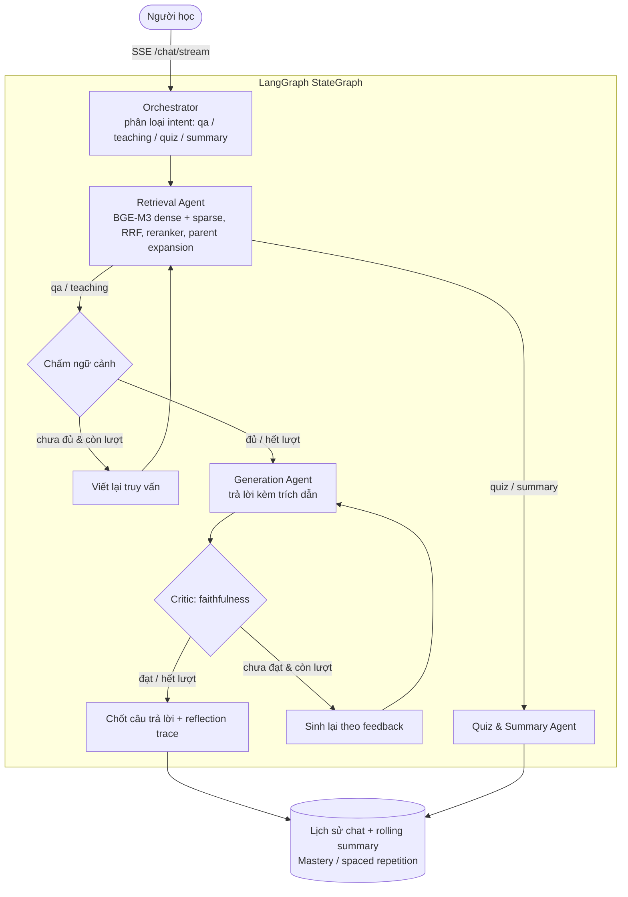

# 🎓 StudyRAG — Multi-Agent Educational RAG Assistant

> 🇬🇧 English version: [README.md](README.md)

<p align="center">
  
  
  
  
  
  
</p>

---

## 1. Tổng quan

**StudyRAG** là trợ lý học tập trên tài liệu của chính người học, dựa trên kiến trúc **Multi-Agent RAG (Corrective RAG + Self-RAG)**:

1. **Giảm ảo giác**: chấm độ đầy đủ của ngữ cảnh trước khi sinh (CRAG) và kiểm tra tính trung thực của câu trả lời sau khi sinh (Self-RAG), có giới hạn số vòng lặp.
2. **Ghi nhớ dài hạn**: quiz được chấm ở server, cập nhật điểm thành thạo theo chủ đề và lịch ôn tập ngắt quãng (spaced repetition).

Giao diện React hiển thị **tiến trình suy luận theo thời gian thực (SSE)** và **trích dẫn bấm được** tới đoạn văn gốc.

---

## 2. Kiến trúc



| Thành phần | Công nghệ |
| :--- | :--- |
| API | FastAPI, SSE, JWT (HS256), argon2id, rate limit theo IP (Redis) |
| Điều phối agent | LangGraph `StateGraph` (`app/graph/build_graph.py`) |
| LLM | Định tuyến cheap/strong theo task (`app/llm/router.py`): Google Gemini (mặc định), OpenAI, Anthropic |
| Embedding / rerank | BGE-M3 (dense 1024 chiều + sparse), `bge-reranker-v2-m3` |
| Lưu trữ | PostgreSQL 16 (Alembic migrations), Qdrant (vector, lọc theo `doc_id`) |
| Ingestion | PDF (PyMuPDF, fallback pypdf, OCR Tesseract tiếng Việt), DOCX, PPTX, TXT, MD |
| Frontend | React 19 + Vite + TypeScript, nginx khi deploy |

### Bảo mật & cô lập dữ liệu
- Mọi route (trừ đăng nhập) yêu cầu JWT; danh tính lấy từ token, không bao giờ từ body.
- Mọi id do client gửi (space, document, session) được kiểm tra quyền sở hữu tại `app/core/ownership.py`; tài nguyên của người khác trả **404**.
- Tìm kiếm vector **bắt buộc** kèm danh sách `doc_id` đã xác thực — không có truy vấn toàn collection.
- Quiz không bao giờ trả đáp án cho client trước khi chấm; mastery chỉ cập nhật sau khi server tự chấm.
- OTP lưu dạng HMAC, giới hạn số lần thử, có thời hạn và cooldown gửi lại.

---

## 3. Cấu trúc thư mục

```
studyRAG/
├── app/
│   ├── main.py            # FastAPI: middleware, lifespan, /health, /ready
│   ├── config.py          # Cấu hình tập trung (pydantic-settings, đọc .env)
│   ├── api/               # routes: auth, spaces, documents, chat (SSE), quiz, mastery
│   ├── core/              # security (JWT/argon2/OTP), ownership, rate_limit, logging
│   ├── db/                # engine + session
│   ├── models/            # SQLAlchemy models + Pydantic schemas
│   ├── ingestion/         # parsers (PDF/DOCX/PPTX/TXT/MD), OCR, cleaning
│   ├── chunking/          # semantic (parent/child theo heading) + fixed (baseline)
│   ├── embedding/         # BGE-M3
│   ├── indexing/          # Qdrant store
│   ├── retrieval/         # query processing, reranker, parent expansion
│   ├── llm/               # router cheap/strong + helper gọi LLM
│   ├── agents/            # orchestrator, retrieval, generation, reflection, quiz/summary
│   ├── graph/             # LangGraph StateGraph + run/stream
│   ├── memory/            # lịch sử chat, context window, mastery tracker
│   └── utils/             # tokens, mailer, ids, time
├── migrations/            # Alembic
├── frontend/              # React + Vite (Dockerfile + nginx.conf để deploy)
├── eval/                  # Bộ đánh giá ablation (xem eval/README.md)
├── scripts/               # init_db.py, seed_demo.py, bench_reranker.py, ...
├── tests/                 # pytest
├── Dockerfile             # image backend
└── docker-compose.yml     # postgres + qdrant + redis + api + web
```

---

## 4. Chạy bằng Docker (khuyến nghị)

```bash
cp .env.example .env
# Bắt buộc điền: POSTGRES_PASSWORD, GOOGLE_API_KEY (hoặc key provider khác)
# Ngoài dev còn bắt buộc: APP_ENV=prod, JWT_SECRET (>= 32 ký tự), SMTP_*, CORS_ORIGINS
docker compose up -d --build
```

Mở **http://localhost:8080**. Backend tự chạy `alembic upgrade head` khi khởi động. Lần đầu xử lý tài liệu, BGE-M3 và reranker (~2–3 GB) được tải về volume `model_cache`; đặt `PRELOAD_MODELS=true` để tải ngay lúc khởi động.

---

## 5. Chạy để phát triển

**Yêu cầu:** Python 3.11, Node.js 20+, Docker (cho Postgres/Qdrant). Tuỳ chọn: `tesseract-ocr` + `tesseract-ocr-vie` để OCR PDF scan.

```bash
# 1. Hạ tầng
cp .env.example .env                       # điền GOOGLE_API_KEY, POSTGRES_PASSWORD
docker compose up -d postgres qdrant

# 2. Backend
python -m venv .venv && source .venv/bin/activate   # Windows: .venv\Scripts\activate
pip install -r requirements-dev.txt
python scripts/init_db.py                  # alembic upgrade head
python scripts/seed_demo.py                # (tuỳ chọn) dữ liệu mẫu: student@studyrag.edu.vn / demo12345
uvicorn app.main:app --reload --port 8000  # Swagger: http://localhost:8000/docs (chỉ APP_ENV=dev)

# 3. Frontend (terminal khác)
cd frontend && npm install && npm run dev  # http://localhost:5173 (proxy /api -> :8000)
```

- Ở `APP_ENV=dev`, nếu Postgres không kết nối được backend tự dùng SQLite `./studyrag.db`; môi trường khác sẽ dừng ngay (fail fast).
- Ở dev, chưa cấu hình SMTP thì mã OTP hiển thị ngay trên màn hình xác thực.
- DB tạo bằng phiên bản cũ (trước khi có Alembic): chạy một lần `alembic stamp 0001_baseline` rồi `python scripts/init_db.py`.

---

### Bật đăng nhập Google (tuỳ chọn)
1. [Google Cloud Console](https://console.cloud.google.com/) → tạo project → **Google Auth Platform** (OAuth consent screen): User type **External**, điền tên app + email; mục **Audience** thêm email của bạn vào **Test users**.
2. **Clients → Create client** → loại **Web application** → **Authorized JavaScript origins** thêm chính xác origin bạn mở app: `http://localhost:5173` (dev), `http://localhost:8080` (Docker), domain thật khi deploy. Không cần Redirect URI.
3. Sao chép **Client ID** vào `.env` của backend: `GOOGLE_OAUTH_CLIENT_ID=...` rồi khởi động lại backend (frontend tự lấy ID qua `/auth/google/config`; không cần Client Secret).

## 6. Kiểm thử & chất lượng

```bash
pytest -q                                   # unit + API tests (SQLite in-memory, không cần LLM/Qdrant)
ruff check app tests migrations scripts
cd frontend && npm run lint && npm run build
```

CI (`.github/workflows/ci.yml`) chạy lint, kiểm tra migration upgrade/downgrade, pytest và build frontend.

### Đánh giá chất lượng RAG
Bộ eval ablation (`dense` → `hybrid` → `hybrid_rerank` → `crag` → `full`) với LLM-as-judge và khoảng tin cậy bootstrap: xem [`eval/README.md`](eval/README.md). Kết quả chỉ được công bố từ `report.md` của một lần chạy thật.

---

## 7. Vận hành production

| Hạng mục | Cách làm |
| :--- | :--- |
| Cấu hình | `APP_ENV=prod` bắt buộc `JWT_SECRET` mạnh; Swagger và đăng nhập dùng thử tự tắt |
| Migration | `alembic upgrade head` (tự chạy trong container); mọi thay đổi schema phải có migration mới |
| Health | `GET /health` (liveness), `GET /ready` (kiểm tra DB + Qdrant, 503 nếu lỗi) |
| Logging | `LOG_FORMAT=json`; mỗi request có `X-Request-ID` xuyên suốt log |
| Rate limit | Theo IP (`RATE_LIMIT_*`). Có `REDIS_URL` → đếm chung mọi instance (compose đã kèm Redis); không có → đếm trong từng tiến trình. nginx giới hạn thêm một lớp ở biên. Redis lỗi → tạm lùi về bộ đếm trong bộ nhớ |
| Scale | 1 worker/container (model nằm trong RAM tiến trình); scale ngang bằng nhiều container |
| Tác vụ nền | Lập chỉ mục tài liệu chạy trong tiến trình; tài liệu dở dang khi restart được đánh dấu `failed` để người dùng tải lại |
| Bí mật | Không commit `.env`; `.dockerignore` loại `.env`, `*.db` khỏi image |

---

## 8. Giấy phép

Dự án **chưa có giấy phép mã nguồn mở**: theo mặc định mọi quyền thuộc về tác giả, người khác không được sao chép, sửa đổi hay phân phối khi chưa được cho phép.
