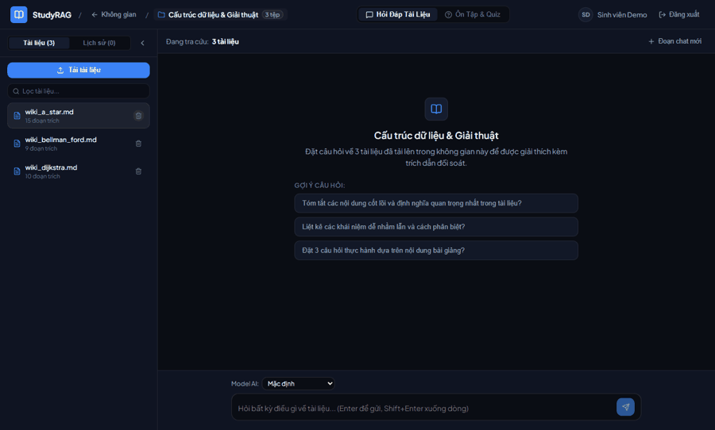

# StuQuiz

Trợ lý học tập trên chính tài liệu của bạn: câu trả lời chỉ dựa trên tài liệu đã tải lên, có trích
dẫn tới đoạn gốc, và từ chối khi tài liệu không có thông tin. Cùng tài liệu đó được dùng để tạo quiz
chấm ở server, kèm điểm thành thạo theo từng chủ đề.

[](https://github.com/VinhDoan1604/StuQuiz/actions/workflows/ci.yml)


🇬🇧 [English version](README.md)

<p align="center"></p>

## Tóm tắt

Tôi đã xây đủ pipeline agentic (corrective RAG, critic tự kiểm tra, hybrid search), rồi đo từng thành
phần bằng bộ ablation. Trên 81 câu hỏi, **CRAG và critic tốn gấp 2–3 lần token mà không cải thiện
chất lượng đo được**, và sparse retrieval không thêm gì khi đã có rerank. Vì vậy bản chạy thật dùng
pipeline đơn giản hơn: tìm kiếm dense, rerank bằng cross-encoder, sinh một lần. Reranker cải thiện rõ
thứ hạng (MRR 0,735 → 0,846), nhưng độ đúng của câu trả lời không đổi, vì bằng chứng thường đã nằm
trong top 5. Các nhánh tốn kém vẫn còn trong code, bật bằng cờ cấu hình.

## Cách hoạt động

1. **Orchestrator** phân loại ý định (`qa`, `teaching`, `quiz`, `summary`) và, trong cùng lời gọi LLM
   đó, viết lại câu nối tiếp như "giải thích đơn giản hơn đi" thành câu hỏi độc lập.
2. **Truy xuất**: BGE-M3 dense top-10 → cross-encoder `bge-reranker-v2-m3` (int8) → mở rộng từ chunk
   con sang chunk cha, luôn lọc theo tài liệu của chính người dùng.
3. **Sinh câu trả lời** chỉ từ đoạn truy xuất được, có số trích dẫn, stream từng token qua SSE. Đoạn
   tài liệu được rào như dữ liệu để chống prompt injection.
4. **Vòng lặp tuỳ chọn** (`ENABLE_CRAG`, `ENABLE_ANSWER_CRITIC`, mặc định tắt): chấm ngữ cảnh và viết lại
   truy vấn, rồi kiểm tra độ trung thành của câu trả lời và sinh lại.

Nạp tài liệu: PDF (PyMuPDF → pypdf → OCR Tesseract `vie`, hoặc `OCR_ENGINE=vlm`), DOCX, PPTX, TXT, MD →
chuẩn hoá Unicode NFC → chunk cha/con theo heading → Qdrant.

| Tầng | Công nghệ |
|---|---|
| API | FastAPI, SSE, JWT, argon2id, Google Sign-In, OTP qua email, rate limit và quota ngày bằng Redis |
| Điều phối | LangGraph `StateGraph` ([`app/graph/build_graph.py`](app/graph/build_graph.py)) |
| Mô hình | Gemini / OpenAI / Anthropic qua router cheap/strong có fallback ([`app/llm/router.py`](app/llm/router.py)); BGE-M3 và reranker tự host |
| Lưu trữ | PostgreSQL 16 + Alembic, Qdrant |
| Frontend | React 19 + Vite + TypeScript, nginx |
| Vận hành | Docker Compose, Caddy (HTTPS), GitHub Actions CI, log JSON có request ID, lưu độ trễ từng node và token cho mỗi câu trả lời |

## Đánh giá

Bộ đo ([`eval/`](eval/README.md)) thêm từng thành phần một, chấm truy xuất (hit@k, MRR) và câu trả lời
(correctness, faithfulness do LLM judge khác model với generator chấm), báo cáo khoảng tin cậy
bootstrap 95 %, dùng paired bootstrap cho các hiệu số.

**`final-v1`**: 81 câu đã duyệt trên 18 tài liệu công khai ([`eval/CORPUS.md`](eval/CORPUS.md)):
58 câu có đáp án, 23 câu không có (12 câu gần đúng), 23 câu viết kiểu sinh viên. Generator
`gemini-2.5-flash`, judge `gpt-5.4`. Báo cáo: [tổng hợp](eval/results/final-v1/report.md),
[production vs CRAG/full](eval/results/final-v1/compare.md),
[dense vs production](eval/results/final-v1/compare_dense.md).

| Cấu hình | Faithfulness | Correctness | Từ chối đúng | p50 độ trễ | Lời gọi LLM | Token |
|---|---|---|---|---|---|---|
| `dense` | 0,949 [0,924–0,972] | 0,957 [0,905–0,991] | 22/23 | 4,6 s | 1,0 | 2.516 |
| **`production`** | **0,968** [0,945–0,988] | **0,957** [0,905–0,991] | **22/22**¹ | 10,3 s | 1,0 | 3.019 |
| `crag` | 0,952 [0,925–0,973] | 0,940 [0,888–0,983] | 22/23 | 14,1 s | 2,7 | 6.087 |
| `full` (CRAG + critic) | 0,963 [0,941–0,982] | 0,957 [0,905–0,991] | 22/23 | 17,8 s | 3,7 | 8.923 |

¹ Một yêu cầu không nhận được phản hồi từ nhà cung cấp LLM nên không có điểm.

- **CRAG và critic không đáng chi phí.** Không chỉ số chất lượng nào tốt hơn `production` (mọi CI đều
  chứa 0); `crag` tốn thêm 3.069 token [2.662–3.531] mỗi câu, `full` thêm 5.851.
- **Tầng truy xuất cải thiện thứ hạng, không cải thiện câu trả lời.** MRR +0,111 [+0,035, +0,189] so với
  `dense`, correctness +0,000 [−0,026, +0,026], chậm thêm 5,8 s mỗi câu. Phần tăng tập trung ở câu
  hỏi viết chuẩn; với câu viết kiểu sinh viên chỉ +0,010 [−0,120, +0,143].
- Trong ablation 48 câu trước đó ([`full-v1`](eval/results/full-v1/report.md)), reranker là thành phần
  duy nhất có cải thiện rõ (MRR +0,17 [+0,09, +0,26]), còn hybrid sparse + RRF không giúp gì.

Các phép đo sau đó ([`eval/FOLLOWUP.md`](eval/FOLLOWUP.md)):

| Thay đổi | Kết quả |
|---|---|
| Độ trễ rerank (int8, max length 384, rerank một lần) | p50 37–43 s → 8,4 s, MRR 0,846–0,854 |
| Viết lại câu nối tiếp trong lời gọi phân loại | 15/15 đúng chủ đề (regex cũ: 2/15) |
| Bộ phân loại ý định | 34/36 đúng, CI 95 % 0,82–0,98 |
| Rào tài liệu chống prompt injection | 13/20 → 0/20 tấn công thành công (10 mẫu tự viết × 2 lần) |
| VLM so với Tesseract trên trang scan ([`ocr-v1`](eval/results/ocr-v1/report.md)) | WER 0,202 → 0,085 (Δ −0,117 [−0,162, −0,059]) nhưng chậm ~6 lần, nên mặc định vẫn là Tesseract |

## Triển khai

Demo trực tuyến: **<https://studyrag-vinh.eastasia.cloudapp.azure.com/>**. Bấm "Dùng thử" để vào
không cần tài khoản; không gian demo chứa bài báo DRR4Covid (xem mục Giấy phép).

- **Server:** Azure `B2als_v2` (2 vCPU, 4 GB RAM, 4 GB swap) ở East Asia, khoảng 38,4 USD mỗi tháng.
- **Stack:** [`docker-compose.prod.yml`](docker-compose.prod.yml) gồm Postgres, Qdrant, Redis, API,
  nginx phục vụ frontend và Caddy đứng trước lo HTTPS. Chỉ Caddy mở cổng ra ngoài.
- **Bộ nhớ:** khi đã nạp BGE-M3 và reranker, container API dùng khoảng 2,3 GB trên giới hạn 3 GB.
- **Đánh đổi:** embedding và rerank chạy trên 2 CPU của server, không có GPU, nên câu trả lời lâu hơn
  rõ so với máy phát triển. Demo có quota riêng theo ngày, vì mỗi câu hỏi đều gọi LLM trả phí.

File production: [`docker-compose.prod.yml`](docker-compose.prod.yml), [`deploy/`](deploy/), [`.env.prod.example`](.env.prod.example).

## Chạy thử

```bash
git clone https://github.com/VinhDoan1604/StuQuiz.git && cd StuQuiz
cp .env.example .env      # điền POSTGRES_PASSWORD và một key LLM (ví dụ GOOGLE_API_KEY)
docker compose up -d --build
```

Mở <http://localhost:8080>. Migration tự chạy khi khởi động; BGE-M3 và reranker (~2–3 GB) được tải
ở lần dùng đầu (`PRELOAD_MODELS=true` để tải ngay lúc khởi động).

<details>
<summary>Phát triển local và kiểm thử</summary>

Python 3.11, Node 20+, Docker cho Postgres/Qdrant. Tuỳ chọn: `tesseract-ocr` + `tesseract-ocr-vie`.

```bash
docker compose up -d postgres qdrant
pip install -r requirements-dev.txt
python scripts/init_db.py                  # alembic upgrade head
uvicorn app.main:app --reload --port 8000
cd frontend && npm install && npm run dev  # http://localhost:5173

pytest -q                                  # 196 test, không cần LLM hay Qdrant
ruff check app tests migrations scripts eval
cd frontend && npm run lint && npm run build
```

CI chạy ruff, kiểm tra migration upgrade/downgrade, pytest và build frontend.

**Bật đăng nhập Google (tuỳ chọn):** trên [Google Cloud Console](https://console.cloud.google.com/)
tạo project → **Google Auth Platform** (External, thêm email của bạn vào **Test users**) →
**Clients → Create client → Web application**, thêm đúng origin đang mở app vào **Authorized
JavaScript origins**. Chép Client ID vào `.env` (`GOOGLE_OAUTH_CLIENT_ID=...`) rồi khởi động lại backend.

</details>

## Hạn chế

- **Bộ eval nhỏ, CI rộng.** Chỉ khẳng định cải thiện thứ hạng và khác biệt chi phí; khác biệt chất
  lượng giữa các cấu hình đều nằm trong CI 95 %.
- **Judge dễ dãi.** Khớp với người chấm ở 17/20 câu, và cả 3 lần lệch đều là judge chấm cao hơn
  (`eval/audit.py`). Correctness tuyệt đối có thể lạc quan; faithfulness chưa được kiểm.
- **Câu hỏi do AI soạn và tôi duyệt**, nên dùng chung từ ngữ với tài liệu, khiến truy xuất trông dễ hơn
  so với câu hỏi thật của sinh viên.
- **Chế độ giảng giải kém bám tài liệu hơn** (faithfulness 0,736 trên 40 câu) vì model tự bịa ví dụ. Đã
  sửa prompt, chưa đo lại.
- **Tỉ lệ từ chối đúng gần trần** (từ 22/23 trở lên ở mọi cấu hình), nên hầu như không phân biệt được cấu hình.
- **VLM mới đo trên 10 trang scan giả lập.**
- Lập chỉ mục chạy trong tiến trình, mỗi lần một file; model nằm trong RAM tiến trình nên mỗi container một worker.

**Tiếp theo:** thay câu hỏi eval do AI soạn bằng câu hỏi thật của sinh viên, rồi dùng chúng để fine-tune
một reranker nhỏ và chỉ chạy CRAG khi điểm truy xuất thấp.

## Tác giả

**Đoàn Công Vinh**, Khoa học Máy tính, Trường Đại học Bách khoa TP.HCM (HCMUT) ·
[GitHub](https://github.com/VinhDoan1604)

## Giấy phép

[AGPL-3.0](LICENSE), theo giấy phép của thư viện PyMuPDF. Tài liệu demo là bài báo
Zhang P., Zhong Y., Deng Y., Tang X., Li X., "DRR4Covid: Learning Automated COVID-19 Infection
Segmentation From Digitally Reconstructed Radiographs", *IEEE Access* 8, 2020,
[doi:10.1109/ACCESS.2020.3038279](https://doi.org/10.1109/ACCESS.2020.3038279), dùng theo giấy phép CC BY 4.0.
