# StudyRAG — Lộ Trình Đọc Hiểu & Kế Hoạch Triển Khai Code (Roadmap)

Tài liệu này đóng vai trò là **kim chỉ nam kỹ thuật** cho dự án **StudyRAG**, bao gồm:
1. **Thứ tự đọc hiểu các file READY**: Giúp nắm bắt kiến trúc nền tảng, hợp đồng dữ liệu (Data Contracts), cấu hình và các API endpoints đã có sẵn.
2. **Thứ tự lập trình các file STUB**: Được sắp xếp tối ưu theo **chuỗi phụ thuộc (dependency graph)** từ tầng thấp (Core/Infra) lên tầng cao (Agents/Graph) và hoàn thiện bằng Evaluation & UI.
3. **Chiến lược kiểm thử từng bước (Verification Strategy)**: Giúp verify độc lập từng module trước khi ghép nối end-to-end.

---

## 1. Tổng Quan Phân Loại Code Trong Repository

Repo được cấu trúc rõ ràng với 2 trạng thái file:
* **`STATUS: READY` (19 files)**: Khung sườn kiến trúc, database schema, Pydantic DTOs, CRUD wrapper, API glue routes và CI/CD. Đã sẵn sàng hoạt động, không cần thay đổi cấu trúc nền tảng.
* **`STATUS: STUB — CẦN ĐẦU TƯ KỸ` (20 files)**: Phần lõi AI/RAG chuyên sâu (Ingestion, BGE-M3 dense/sparse, Reranker, Context Management, Mastery Tracking SM-2, LangGraph Multi-Agent với Reflection Loop, RAGAS Eval).

```mermaid
graph TD
    subgraph READY_LAYER ["Layer 1: Sẵn Sàng (READY)"]
        Config["Config & Logging"]
        DB["DB Models & Schemas"]
        State["GraphState Contract"]
        APIGlue["FastAPI Endpoints"]
        QdrantWrapper["Qdrant Store (Base)"]
    end

    subgraph CORE_SERVICES ["Phase 1: Core AI Services (STUB)"]
        Router["LLM Router"]
        Embedder["BGE-M3 Embedder"]
        HybridSearch["Qdrant Hybrid Search"]
    end

    subgraph INGESTION ["Phase 2: Ingestion & Chunking (STUB)"]
        OCR["OCR Fallback"]
        Parsers["Doc Parsers"]
        Clean["Cleaning NFC"]
        SemanticChunk["Semantic Chunker"]
    end

    subgraph RETRIEVAL_MEM ["Phase 3: Retrieval & Memory (STUB)"]
        QueryProc["Query Rewrite & Decompose"]
        Rerank["BGE Reranker"]
        ContextWin["Context Window & Summary"]
        Mastery["Mastery Tracker (Spaced Review)"]
    end

    subgraph AGENTS_GRAPH ["Phase 4 & 5: Multi-Agent & LangGraph (STUB)"]
        Orchestrator["Orchestrator Agent"]
        RetrievalAgent["Retrieval Agent"]
        ReflectionAgent["Reflection/Critic Agent"]
        GenAgent["Generation Agent"]
        QuizSummaryAgent["Quiz & Summary Agent"]
        LangGraph["LangGraph StateGraph"]
    end

    subgraph UI_EVAL ["Phase 6: Evaluation & UI (STUB)"]
        Seed["Seed Demo"]
        Streamlit["Streamlit UI (Trace Timeline)"]
        Ragas["RAGAS Eval"]
        QuizEval["Quiz/Summary Eval"]
    end

    READY_LAYER --> CORE_SERVICES
    CORE_SERVICES --> INGESTION
    CORE_SERVICES --> RETRIEVAL_MEM
    INGESTION --> RETRIEVAL_MEM
    RETRIEVAL_MEM --> AGENTS_GRAPH
    AGENTS_GRAPH --> UI_EVAL
```



---

## 2. Thứ Tự Đọc Hiểu Các File READY (Reading Order)

Để không bị ngợp, hãy đọc các file `READY` theo chiều **Bottom-Up** (Hạ tầng $\rightarrow$ Dữ liệu $\rightarrow$ Wrapper lưu trữ $\rightarrow$ API routing).

```
┌─────────────────────────────────────────────────────────────────────────┐
│ Bước 1: Hạ tầng & Cấu hình (Docker, Config, Logging)                    │
│   ├── docker-compose.yml & Dockerfile & requirements.txt                │
│   ├── app/config.py                                                     │
│   └── app/core/logging_config.py                                        │
└────────────────────────────────────┬────────────────────────────────────┘
                                     │
┌────────────────────────────────────▼────────────────────────────────────┐
│ Bước 2: Hợp Đồng Dữ Liệu & Data Models (QUAN TRỌNG NHẤT)                │
│   ├── app/db/session.py & scripts/init_db.py                            │
│   ├── app/models/db_models.py (Postgres Tables)                         │
│   ├── app/models/schemas.py (Pydantic API DTOs)                         │
│   └── app/agents/state.py (LangGraph State Contract)                    │
└────────────────────────────────────┬────────────────────────────────────┘
                                     │
┌────────────────────────────────────▼────────────────────────────────────┐
│ Bước 3: Storage Wrappers & Baseline Components                          │
│   ├── app/indexing/qdrant_store.py (Schema collection & Upsert)         │
│   ├── app/chunking/fixed_chunker.py (Dataclass Chunk & Tokenizer)       │
│   └── app/memory/chat_history.py (CRUD Session & Turns)                 │
└────────────────────────────────────┬────────────────────────────────────┘
                                     │
┌────────────────────────────────────▼────────────────────────────────────┐
│ Bước 4: API Glue Layer & Entrypoints                                    │
│   ├── app/main.py                                                       │
│   ├── app/api/routes_documents.py                                       │
│   ├── app/api/routes_chat.py                                            │
│   ├── app/api/routes_quiz.py                                            │
│   ├── app/api/routes_mastery.py                                         │
│   └── tests/test_health.py & .github/workflows/ci.yml                   │
└─────────────────────────────────────────────────────────────────────────┘
```

### Bước 1: Hạ Tầng & Cấu Hình Tập Trung
1. [docker-compose.yml](file:///c:/Users/Lenovo/Downloads/studyRAG/docker-compose.yml) & [Dockerfile](file:///c:/Users/Lenovo/Downloads/studyRAG/Dockerfile):
   - Chạy 2 service chính: **PostgreSQL** (port 5432) cho relational data và **Qdrant** (port 6333) cho vector embeddings.
   - Hiểu các biến môi trường và volume mount.
2. [requirements.txt](file:///c:/Users/Lenovo/Downloads/studyRAG/requirements.txt):
   - Các thư viện cốt lõi: `fastapi`, `sqlalchemy`, `langgraph`, `FlagEmbedding` (BGE-M3 + Reranker), `ragas`, `streamlit`.
3. [app/config.py](file:///c:/Users/Lenovo/Downloads/studyRAG/app/config.py):
   - Đọc cấu hình từ `.env` qua `pydantic-settings`.
   - Nắm các tham số: `postgres_dsn`, `qdrant_url`, `cheap_model_*` (gpt-4o-mini), `strong_model_*` (claude-sonnet-4-6), `max_reflection_loops = 2`.
4. [app/core/logging_config.py](file:///c:/Users/Lenovo/Downloads/studyRAG/app/core/logging_config.py):
   - Thiết lập format log chuẩn cho toàn bộ ứng dụng.

### Bước 2: Hợp Đồng Dữ Liệu (Data Contracts) — Cốt Lõi Kiến Trúc
5. [app/db/session.py](file:///c:/Users/Lenovo/Downloads/studyRAG/app/db/session.py) & [scripts/init_db.py](file:///c:/Users/Lenovo/Downloads/studyRAG/scripts/init_db.py):
   - Cách tạo SQLAlchemy engine, `SessionLocal`, dependency `get_db` và script khởi tạo bảng trong Postgres.
6. [app/models/db_models.py](file:///c:/Users/Lenovo/Downloads/studyRAG/app/models/db_models.py):
   - Đọc kỹ 6 thực thể quan hệ:
     - `User`: Người dùng hệ thống.
     - `Document`: Metadata tài liệu tải lên (filename, file_type, subject, num_chunks).
     - `ChatSession`: Phiên trò chuyện, chứa `rolling_summary` (do Memory Manager tóm tắt).
     - `ChatTurn`: Từng lượt chat, lưu `role`, `intent`, `content` và đặc biệt là trường `reflection_trace` (JSON).
     - `QuizAttempt`: Lưu lịch sử trả lời trắc nghiệm của sinh viên.
     - `MasteryRecord`: Bảng cốt lõi của tính năng spaced review (`topic`, `correct_count`, `incorrect_count`, `mastery_score`, `next_review_due_at`).
7. [app/models/schemas.py](file:///c:/Users/Lenovo/Downloads/studyRAG/app/models/schemas.py):
   - Các schema Pydantic giao tiếp ra bên ngoài:
     - `ChatRequest`, `ChatResponse`: Bao gồm cả `ReflectionTrace` (context_grade, answer_grade, num_loops, rewritten_queries) trả về cho UI hiển thị tính minh bạch.
     - `QuizQuestion`, `QuizGenerateRequest`: Format tạo bài trắc nghiệm.
     - `MasteryTopic`: Schema trả về các chủ đề yếu cần ôn tập.
8. [app/agents/state.py](file:///c:/Users/Lenovo/Downloads/studyRAG/app/agents/state.py):
   - **File quan trọng nhất để làm việc với Multi-Agent**:
     - `ReflectionResult`: Chứa điểm đánh giá context/answer (`context_grade`, `context_sufficient`, `answer_grade`, `answer_faithful`, `feedback`).
     - `GraphState`: State dùng chung truyền qua tất cả các node trong LangGraph (`session_id`, `user_query`, `intent`, `suggested_review_topic`, `retrieved_chunks`, `reflection_history`, `num_reflection_loops`, `answer_draft`, `final_answer`, `citations`, `chat_history_summary`, `mastery_context`).

### Bước 3: Storage Wrappers & Baseline Components
9. [app/indexing/qdrant_store.py](file:///c:/Users/Lenovo/Downloads/studyRAG/app/indexing/qdrant_store.py):
   - Xem cấu hình collection `studyrag_chunks`: Dense vector 1024 chiều (Cosine distance) + Sparse vector (cho lexical/sparse search từ BGE-M3).
   - Hàm `upsert_chunks()` đã sẵn sàng. Lưu ý: hàm `hybrid_search()` hiện đang là stub cần implement ở Phase 1.
10. [app/chunking/fixed_chunker.py](file:///c:/Users/Lenovo/Downloads/studyRAG/app/chunking/fixed_chunker.py):
    - Đọc dataclass `Chunk(text, source_file, page, section, content_type)`. Đây là dataclass chuẩn được tái sử dụng trong cả hệ thống.
    - Hiểu thuật toán baseline chunking cố định bằng tokenizer `cl100k_base`.
11. [app/memory/chat_history.py](file:///c:/Users/Lenovo/Downloads/studyRAG/app/memory/chat_history.py):
    - Các hàm CRUD cơ bản với Postgres: `get_or_create_session()`, `add_turn()`, `get_recent_turns()`.

### Bước 4: API Controllers & Entrypoints
12. [app/main.py](file:///c:/Users/Lenovo/Downloads/studyRAG/app/main.py):
    - Khởi tạo FastAPI app, gắn các router: `/documents`, `/chat`, `/quiz`, `/mastery` và endpoint `/health`.
13. [app/api/routes_documents.py](file:///c:/Users/Lenovo/Downloads/studyRAG/app/api/routes_documents.py):
    - Nhận file upload, gọi pipeline parse $\rightarrow$ chunk $\rightarrow$ embed $\rightarrow$ upsert Qdrant $\rightarrow$ lưu Postgres.
14. [app/api/routes_chat.py](file:///c:/Users/Lenovo/Downloads/studyRAG/app/api/routes_chat.py):
    - Gọi trực tiếp `run_graph(session_id, message)`.
15. [app/api/routes_quiz.py](file:///c:/Users/Lenovo/Downloads/studyRAG/app/api/routes_quiz.py) & [app/api/routes_mastery.py](file:///c:/Users/Lenovo/Downloads/studyRAG/app/api/routes_mastery.py):
    - Gọi logic quiz generation và mastery weak topics.
16. [tests/test_health.py](file:///c:/Users/Lenovo/Downloads/studyRAG/tests/test_health.py) & [.github/workflows/ci.yml](file:///c:/Users/Lenovo/Downloads/studyRAG/.github/workflows/ci.yml):
    - Kiểm tra endpoint `/health` và CI GitHub Actions chạy pytest khi push/PR.

---

## 3. Thứ Tự Code Các File STUB (Implementation Order)

Thứ tự code được chia thành **6 Phase lũy tiến**, đảm bảo mỗi module viết xong đều có thể kiểm thử đơn vị ngay lập tức mà không bị vướng lỗi phụ thuộc vòng tròn (circular dependency).

```
Phase 1: Hạ Tầng AI Cốt Lõi (LLM Router & BGE-M3 & Hybrid Search)
  ├── 1. app/llm/router.py
  ├── 2. app/embedding/bge_m3_embedder.py
  └── 3. Hoàn thiện app/indexing/qdrant_store.py (hybrid_search)
          │
Phase 2: Ingestion & Chunking Pipeline (Xử lý tài liệu đầu vào)
  ├── 4. app/ingestion/ocr.py
  ├── 5. app/ingestion/parsers.py
  ├── 6. app/ingestion/cleaning.py
  └── 7. app/chunking/semantic_chunker.py
          │
Phase 3: Retrieval & Memory Management
  ├── 8. app/retrieval/query_processing.py
  ├── 9. app/retrieval/reranker.py
  ├── 10. app/memory/context_window.py
  └── 11. app/memory/mastery_tracker.py
          │
Phase 4: Các Agent Nodes Độc Lập
  ├── 12. app/agents/orchestrator_agent.py
  ├── 13. app/agents/retrieval_agent.py
  ├── 14. app/agents/generation_agent.py
  ├── 15. app/agents/reflection_agent.py
  └── 16. app/agents/quiz_summary_agent.py
          │
Phase 5: Lắp Ráp LangGraph StateGraph (End-to-End Orchestration)
  └── 17. app/graph/build_graph.py
          │
Phase 6: Seeding, UI & Evaluation Chuyên Sâu
  ├── 18. scripts/seed_demo.py
  ├── 19. frontend/streamlit_app.py
  ├── 20. eval/ragas_eval.py
  └── 21. eval/quiz_eval.py
```

---

### Chi Tiết Từng Phase & Yêu Cầu Kỹ Thuật

#### Phase 1: Hạ Tầng AI Cốt Lõi (Model Routing & Embeddings)
*Mục tiêu: Đảm bảo có LLM và Vector Store sẵn sàng phục vụ các agent và pipeline ingestion.*

1. **[app/llm/router.py](file:///c:/Users/Lenovo/Downloads/studyRAG/app/llm/router.py)**:
   - **Nhiệm vụ**: Cài đặt hàm `get_llm(task: TaskType)`.
   - **Nguyên lý**: 
     - Trả về Cheap Model (`gpt-4o-mini`) cho các task: `rewrite`, `decompose`, `grade`.
     - Trả về Strong Model (`claude-sonnet-4-6` hoặc `gpt-4o`) cho các task: `teaching`, `summary`, `quiz`. Task `qa` có thể tùy biến theo độ phức tạp.
     - Cấu hình temperature (thấp 0.0 - 0.2 cho grading/retrieval; trung bình 0.5 - 0.7 cho teaching/quiz).
     - Tích hợp callback đo đếm token usage và latency cho phục vụ evaluation sau này.
2. **[app/embedding/bge_m3_embedder.py](file:///c:/Users/Lenovo/Downloads/studyRAG/app/embedding/bge_m3_embedder.py)**:
   - **Nhiệm vụ**: Cài đặt `embed_chunks(texts)` và `embed_query(text)`.
   - **Kỹ thuật**: Sử dụng `FlagEmbedding.BGEM3FlagModel` sinh đồng thời:
     - Vector dày (Dense vector): 1024 chiều.
     - Vector thưa (Lexical/Sparse vector): dict `{"indices": [...], "values": [...]}` thay thế BM25 truyền thống.
   - Thêm cơ chế batching chống OOM và hash caching.
3. **Hoàn thiện hàm `hybrid_search()` trong [app/indexing/qdrant_store.py](file:///c:/Users/Lenovo/Downloads/studyRAG/app/indexing/qdrant_store.py)**:
   - **Nhiệm vụ**: Viết truy vấn Reciprocal Rank Fusion (RRF) hoặc weighted sum kết hợp giữa vector `dense` và vector `sparse` trên Qdrant Query API.
   - Hỗ trợ metadata filtering (theo `source_file`, `subject`).

---

#### Phase 2: Ingestion & Chunking Pipeline (Xử Lý Tài Liệu Đầu Vào)
*Mục tiêu: Kích hoạt hoàn toàn endpoint `POST /documents/upload`.*

4. **[app/ingestion/ocr.py](file:///c:/Users/Lenovo/Downloads/studyRAG/app/ingestion/ocr.py)**:
   - **Nhiệm vụ**: Hàm `ocr_page_image(image_bytes, lang="vie")`.
   - Sử dụng `pytesseract` với model tiếng Việt (`vie`). Đóng vai trò cứu cánh khi trang PDF scan không có text layer.
5. **[app/ingestion/parsers.py](file:///c:/Users/Lenovo/Downloads/studyRAG/app/ingestion/parsers.py)**:
   - **Nhiệm vụ**: Cài đặt `parse_document(raw_bytes, filename) -> ParsedDocument`.
   - Trích xuất giữ nguyên cấu trúc ngữ nghĩa:
     - **PDF** (`pypdf`): Đọc theo trang, tính tỷ lệ text; nếu trang rỗng $\rightarrow$ kích hoạt OCR.
     - **DOCX** (`python-docx`): Đọc paragraph styles (Heading 1/2/3 để giữ hierarchy) và bảng biểu (`doc.tables`).
     - **PPTX** (`python-pptx`): Mỗi slide là 1 section, trích xuất slide title, bullet points và speaker notes.
6. **[app/ingestion/cleaning.py](file:///c:/Users/Lenovo/Downloads/studyRAG/app/ingestion/cleaning.py)**:
   - **Nhiệm vụ**: Hàm `clean_document(doc) -> ParsedDocument`.
   - Chuẩn hóa Unicode tiếng Việt dạng **NFC** (`unicodedata.normalize('NFC', text)`).
   - Khử header/footer lặp (thuật toán đối chiếu dòng đầu/cuối giữa các trang, dòng nào xuất hiện lặp >60% số trang thì loại bỏ), xóa số trang và watermark rác.
7. **[app/chunking/semantic_chunker.py](file:///c:/Users/Lenovo/Downloads/studyRAG/app/chunking/semantic_chunker.py)**:
   - **Nhiệm vụ**: Cài đặt `chunk_document(doc) -> list[Chunk]`.
   - **Kỹ thuật Hierarchical + Semantic**:
     - Cắt ranh giới dựa theo heading/section thay vì đếm token cứng.
     - Sinh chunk 2 tầng: Chunk con (~200-400 tokens) để retrieve chính xác, liên kết với ID của Section/Parent chunk lớn hơn để mở rộng ngữ cảnh khi Reflection Agent yêu cầu.
     - Gắn metadata: `source_file`, `page`, `section`, `content_type` (`definition`, `example`, `exercise`).

---

#### Phase 3: Retrieval & Memory Management
*Mục tiêu: Chuẩn bị khả năng xử lý câu hỏi thông minh và lưu giữ trí nhớ học tập của sinh viên.*

8. **[app/retrieval/query_processing.py](file:///c:/Users/Lenovo/Downloads/studyRAG/app/retrieval/query_processing.py)**:
   - **Nhiệm vụ**:
     - `rewrite_query(query, chat_history_summary)`: Sử dụng Cheap LLM giải quyết các đại từ thay thế ("nó", "phần trước", "định lý đó").
     - `decompose_query(query)`: Phân rã câu hỏi phức hợp multi-hop thành danh sách các sub-queries độc lập.
9. **[app/retrieval/reranker.py](file:///c:/Users/Lenovo/Downloads/studyRAG/app/retrieval/reranker.py)**:
   - **Nhiệm vụ**: Cài đặt `rerank(query, candidates, top_k=5)`.
   - Sử dụng `FlagEmbedding.FlagReranker("BAAI/bge-reranker-v2-m3")`. Chấm điểm cặp `(query, chunk_text)` từ top-20 hybrid search xuống top-5 chuẩn xác nhất.
10. **[app/memory/context_window.py](file:///c:/Users/Lenovo/Downloads/studyRAG/app/memory/context_window.py)**:
    - **Nhiệm vụ**:
      - `build_context(db, session_id, token_budget) -> str`: Kết hợp sliding window (N turns gần nhất) + `rolling_summary`. Đếm token bằng `tiktoken` để không bao giờ tràn context window.
      - `maybe_summarize(db, session_id)`: Khi số lượt chat tích lũy vượt ngưỡng, dùng LLM tóm tắt nén vào `ChatSession.rolling_summary`.
11. **[app/memory/mastery_tracker.py](file:///c:/Users/Lenovo/Downloads/studyRAG/app/memory/mastery_tracker.py)**:
    - **Nhiệm vụ**:
      - `record_quiz_result(db, user_id, topic, is_correct)`: Cập nhật `MasteryRecord`. Điểm `mastery_score` (0-100) tăng khi đúng (+10), giảm mạnh hơn khi sai (-15) (bất đối xứng để đảm bảo độ chắc chắn).
      - Tính lịch lặp lại ngắt quãng (**Spaced Repetition**): Đặt `next_review_due_at` theo streak (1 ngày $\rightarrow$ 3 ngày $\rightarrow$ 7 ngày $\rightarrow$ 14 ngày).
      - `get_weak_topics(db, user_id, limit=5)`: Trả về các topic điểm thấp hoặc đã quá hạn ôn tập (`next_review_due_at < now`).

---

#### Phase 4: Các Agent Nodes Độc Lập
*Mục tiêu: Xây dựng từng node chuyên biệt theo đúng schema `GraphState` trước khi ghép graph.*

12. **[app/agents/orchestrator_agent.py](file:///c:/Users/Lenovo/Downloads/studyRAG/app/agents/orchestrator_agent.py)**:
    - **Nhiệm vụ**: Cài đặt `async run_orchestrator(state: GraphState) -> GraphState`.
    - Dùng Cheap LLM với structured output JSON để phân loại intent: `qa`, `teaching`, `quiz`, `summary`.
    - Kiểm tra `mastery_context`: Nếu người dùng hỏi chung chung và có chủ đề yếu đang đến hạn ôn tập, tự động gắn `suggested_review_topic` để gợi ý ôn tập chủ động.
13. **[app/agents/retrieval_agent.py](file:///c:/Users/Lenovo/Downloads/studyRAG/app/agents/retrieval_agent.py)**:
    - **Nhiệm vụ**: Cài đặt `async run_retrieval(state: GraphState) -> GraphState`.
    - Kết nối pipeline: Rewrite/Decompose $\rightarrow$ Embed $\rightarrow$ Qdrant Hybrid Search $\rightarrow$ BGE Reranker $\rightarrow$ Cập nhật `state["retrieved_chunks"]` và `state["rewritten_queries"]`.
    - Thiết kế đảm bảo tính *idempotent* (không bị lỗi side-effect khi bị gọi lặp lại từ Reflection loop).
14. **[app/agents/generation_agent.py](file:///c:/Users/Lenovo/Downloads/studyRAG/app/agents/generation_agent.py)**:
    - **Nhiệm vụ**: Cài đặt `async run_generation(state: GraphState) -> GraphState`.
    - Xử lý 2 chế độ:
      - **QA Mode**: Trả lời trực diện, đính kèm citation chi tiết (`file`, `page`, `section`).
      - **Teaching Mode**: Sử dụng Strong LLM, giải thích theo phương pháp giàn giáo (Scaffolding: Khái niệm $\rightarrow$ Bản chất $\rightarrow$ Ví dụ minh họa) kèm câu hỏi gợi mở phong cách Socratic nhẹ.
    - Nhận `feedback` từ lần chấm trước của Reflection Agent để sửa bài viết nếu có.
15. **[app/agents/reflection_agent.py](file:///c:/Users/Lenovo/Downloads/studyRAG/app/agents/reflection_agent.py)**:
    - **Nhiệm vụ**: Hiện thực hóa **CRAG (Corrective RAG)** và **Self-RAG** — điểm nhấn kỹ thuật quan trọng nhất.
    - Cài đặt 2 hàm:
      - `async grade_context(state: GraphState) -> ReflectionResult`: Chấm điểm độ liên quan và tính đầy đủ của context so với câu hỏi. Nếu không đủ $\rightarrow$ kích hoạt rewrite query để retrieve lại.
      - `async grade_answer(state: GraphState) -> ReflectionResult`: Chấm tính trung thực (*faithfulness* — tránh ảo giác/hallucination) so với context đã cung cấp. Nếu bịa đặt hoặc thiếu ý $\rightarrow$ yêu cầu Generation Agent viết lại kèm phản hồi chi tiết.
16. **[app/agents/quiz_summary_agent.py](file:///c:/Users/Lenovo/Downloads/studyRAG/app/agents/quiz_summary_agent.py)**:
    - **Nhiệm vụ**:
      - `generate_quiz()`: Lấy weak topics từ `mastery_tracker`, sinh câu hỏi trắc nghiệm 4 lựa chọn có đáp án và giải thích chi tiết, tránh trùng lặp với `QuizAttempt` cũ trong DB.
      - `generate_summary()`: Tóm tắt đa tài liệu có cấu trúc phân cấp, áp dụng map-reduce nếu vượt quá token context.

---

#### Phase 5: Lắp Ráp LangGraph StateGraph (End-to-End Orchestration)
*Mục tiêu: Đưa toàn bộ hệ thống vào một State Machine hoàn chỉnh, kích hoạt endpoint `POST /chat`.*

17. **[app/graph/build_graph.py](file:///c:/Users/Lenovo/Downloads/studyRAG/app/graph/build_graph.py)**:
    - **Nhiệm vụ**: Cài đặt hàm `run_graph(session_id, user_message) -> dict`.
    - Xây dựng `StateGraph(GraphState)`:
      - Node `orchestrator` $\rightarrow$ rẽ nhánh theo `intent`:
        - Nhánh `qa` / `teaching`: `retrieval` $\rightarrow$ `grade_context` $\rightarrow$ (nếu thiếu & loop < max: loop rewrite $\rightarrow$ `retrieval`; nếu đủ: `generation`) $\rightarrow$ `grade_answer` $\rightarrow$ (nếu chưa đạt & loop < max: loop `generation`; nếu đạt: `END`).
        - Nhánh `quiz`: `retrieval` (ưu tiên weak topics) $\rightarrow$ `quiz_summary` $\rightarrow$ `END`.
        - Nhánh `summary`: `retrieval` (full scope) $\rightarrow$ `quiz_summary` $\rightarrow$ `END`.
    - Kiểm soát vòng lặp: Đếm `num_reflection_loops` và thiết lập `recursion_limit` của LangGraph để triệt tiêu nguy cơ lặp vô hạn.
    - Tích hợp Memory: Đọc context trước khi invoke graph và lưu turn/cập nhật mastery vào DB sau khi kết thúc graph.

---

#### Phase 6: Seeding, UI & Evaluation Chuyên Sâu
*Mục tiêu: Tạo sản phẩm hoàn chỉnh để demo trực quan và có bảng số liệu benchmark thuyết phục.*

18. **[scripts/seed_demo.py](file:///c:/Users/Lenovo/Downloads/studyRAG/scripts/seed_demo.py)**:
    - Tự động tạo 1 user demo, tải lên sẵn 2-3 tài liệu học tập mẫu (slide bài giảng, giáo trình PDF) qua ingestion pipeline thật.
19. **[frontend/streamlit_app.py](file:///c:/Users/Lenovo/Downloads/studyRAG/frontend/streamlit_app.py)**:
    - Giao diện Streamlit đa màn hình:
      - **Upload & Document Manager**: Quản lý tài liệu đã tải lên.
      - **Chat Workspace (QA / Teaching)**: Hiển thị khung chat kèm **Reflection Trace Timeline trực quan** (điểm context, rewrite queries, faithfulness score, số vòng reflection).
      - **Interactive Quiz**: Làm bài trắc nghiệm tương tác trực tiếp.
      - **Mastery Dashboard**: Biểu đồ trực quan hóa điểm mastery từng topic và cảnh báo các chủ đề đến hạn ôn tập.
20. **[eval/ragas_eval.py](file:///c:/Users/Lenovo/Downloads/studyRAG/eval/ragas_eval.py)**:
    - Đánh giá offline 4 chỉ số vàng của RAGAS: `faithfulness`, `answer_relevancy`, `context_precision`, `context_recall`.
    - Chạy benchmark so sánh: **Baseline (No Reflection)** vs **StudyRAG (With Reflection Loop)** để chứng minh giá trị thực tế của giải pháp.
21. **[eval/quiz_eval.py](file:///c:/Users/Lenovo/Downloads/studyRAG/eval/quiz_eval.py)**:
    - Dùng LLM-as-judge đánh giá độ phân loại của bài trắc nghiệm và độ bao phủ (*coverage*) của bài tóm tắt; đo đếm latency và chi phí token.

---

## 4. Bảng Tra Cứu Nhanh Từng File & Độ Ưu Tiên

| Thứ tự | File Path | Trạng thái | Thuộc Phase | Độ ưu tiên | Phụ thuộc chính |
|:---:|---|:---:|:---:|:---:|---|
| **1** | [app/llm/router.py](file:///c:/Users/Lenovo/Downloads/studyRAG/app/llm/router.py) | STUB | Phase 1 | Cực cao | `config.py` |
| **2** | [app/embedding/bge_m3_embedder.py](file:///c:/Users/Lenovo/Downloads/studyRAG/app/embedding/bge_m3_embedder.py) | STUB | Phase 1 | Cực cao | `FlagEmbedding` |
| **3** | [app/indexing/qdrant_store.py](file:///c:/Users/Lenovo/Downloads/studyRAG/app/indexing/qdrant_store.py) (`hybrid_search`) | READY/STUB | Phase 1 | Cực cao | `config.py`, `qdrant-client` |
| **4** | [app/ingestion/ocr.py](file:///c:/Users/Lenovo/Downloads/studyRAG/app/ingestion/ocr.py) | STUB | Phase 2 | Trung bình | `pytesseract` |
| **5** | [app/ingestion/parsers.py](file:///c:/Users/Lenovo/Downloads/studyRAG/app/ingestion/parsers.py) | STUB | Phase 2 | Cao | `ocr.py`, `pypdf`, `python-docx` |
| **6** | [app/ingestion/cleaning.py](file:///c:/Users/Lenovo/Downloads/studyRAG/app/ingestion/cleaning.py) | STUB | Phase 2 | Cao | `parsers.py` |
| **7** | [app/chunking/semantic_chunker.py](file:///c:/Users/Lenovo/Downloads/studyRAG/app/chunking/semantic_chunker.py) | STUB | Phase 2 | Cao | `cleaning.py`, `fixed_chunker.py` |
| **8** | [app/retrieval/query_processing.py](file:///c:/Users/Lenovo/Downloads/studyRAG/app/retrieval/query_processing.py) | STUB | Phase 3 | Cao | `router.py` |
| **9** | [app/retrieval/reranker.py](file:///c:/Users/Lenovo/Downloads/studyRAG/app/retrieval/reranker.py) | STUB | Phase 3 | Cao | `FlagEmbedding` |
| **10** | [app/memory/context_window.py](file:///c:/Users/Lenovo/Downloads/studyRAG/app/memory/context_window.py) | STUB | Phase 3 | Cao | `chat_history.py`, `router.py` |
| **11** | [app/memory/mastery_tracker.py](file:///c:/Users/Lenovo/Downloads/studyRAG/app/memory/mastery_tracker.py) | STUB | Phase 3 | Cực cao | `db_models.py`, `schemas.py` |
| **12** | [app/agents/orchestrator_agent.py](file:///c:/Users/Lenovo/Downloads/studyRAG/app/agents/orchestrator_agent.py) | STUB | Phase 4 | Cao | `router.py`, `state.py` |
| **13** | [app/agents/retrieval_agent.py](file:///c:/Users/Lenovo/Downloads/studyRAG/app/agents/retrieval_agent.py) | STUB | Phase 4 | Cao | `query_processing.py`, `qdrant_store.py`, `reranker.py` |
| **14** | [app/agents/generation_agent.py](file:///c:/Users/Lenovo/Downloads/studyRAG/app/agents/generation_agent.py) | STUB | Phase 4 | Cao | `router.py`, `state.py` |
| **15** | [app/agents/reflection_agent.py](file:///c:/Users/Lenovo/Downloads/studyRAG/app/agents/reflection_agent.py) | STUB | Phase 4 | Cực cao | `router.py`, `state.py` |
| **16** | [app/agents/quiz_summary_agent.py](file:///c:/Users/Lenovo/Downloads/studyRAG/app/agents/quiz_summary_agent.py) | STUB | Phase 4 | Cao | `router.py`, `mastery_tracker.py` |
| **17** | [app/graph/build_graph.py](file:///c:/Users/Lenovo/Downloads/studyRAG/app/graph/build_graph.py) | STUB | Phase 5 | Cực cao | Toàn bộ các agent trong `app/agents/*` |
| **18** | [scripts/seed_demo.py](file:///c:/Users/Lenovo/Downloads/studyRAG/scripts/seed_demo.py) | STUB | Phase 6 | Vừa | Ingestion pipeline hoàn chỉnh |
| **19** | [frontend/streamlit_app.py](file:///c:/Users/Lenovo/Downloads/studyRAG/frontend/streamlit_app.py) | STUB | Phase 6 | Cao | FastAPI backend (`routes_*`) |
| **20** | [eval/ragas_eval.py](file:///c:/Users/Lenovo/Downloads/studyRAG/eval/ragas_eval.py) | STUB | Phase 6 | Cực cao | `build_graph.py`, `ragas` |
| **21** | [eval/quiz_eval.py](file:///c:/Users/Lenovo/Downloads/studyRAG/eval/quiz_eval.py) | STUB | Phase 6 | Vừa | `quiz_summary_agent.py` |

---

## 5. Chiến Lược Kiểm Thử Từng Bước (Verification Strategy)

Không đợi toàn bộ hệ thống hoàn thành mới test. Hãy áp dụng quy trình kiểm thử theo từng Phase:

1. **Sau Phase 1 (Core Services)**:
   - Viết scratch test gọi `get_llm("rewrite")` và `get_llm("teaching")` sinh text thử nghiệm.
   - Thử `embed_chunks(["Xin chào thế giới"])` kiểm tra shape dense vector (1024) và sparse keys.
   - Gọi `hybrid_search` trên Qdrant local để xác nhận kết nối Qdrant mượt mà.
2. **Sau Phase 2 (Ingestion)**:
   - Chạy test upload 1 file PDF và 1 file DOCX thông qua endpoint `/documents/upload`.
   - Kiểm tra xem điểm dữ liệu đã xuất hiện trong collection Qdrant và bảng `documents` trong Postgres chưa.
3. **Sau Phase 3 (Retrieval & Memory)**:
   - Test hàm `rewrite_query("nó là gì?", chat_history_summary="Đang thảo luận về thuật toán Dijkstra")`.
   - Test cập nhật `record_quiz_result` trong DB và gọi `get_weak_topics` xem logic streak và hạn ôn tập hoạt động chuẩn xác không.
4. **Sau Phase 4 & 5 (Agents & LangGraph)**:
   - Gọi `run_graph()` với câu hỏi test có ngữ cảnh rõ ràng và câu hỏi thiếu thông tin để quan sát xem **Reflection Loop** có kích hoạt nhảy nhánh viết lại query và chấm điểm faithfulness không.
   - Gửi request đến `POST /chat` và kiểm tra response nhận được có chứa đầy đủ trường `reflection` trace.
5. **Sau Phase 6 (End-to-End Demo & Eval)**:
   - Chạy `streamlit run frontend/streamlit_app.py` và trải nghiệm toàn bộ hành trình người dùng: Upload tài liệu $\rightarrow$ Hỏi đáp quan sát Reflection Trace $\rightarrow$ Làm Quiz trắc nghiệm $\rightarrow$ Xem bảng Mastery Dashboard.
   - Chạy `python eval/ragas_eval.py` để xuất bảng điểm 4 chỉ số RAGAS.
